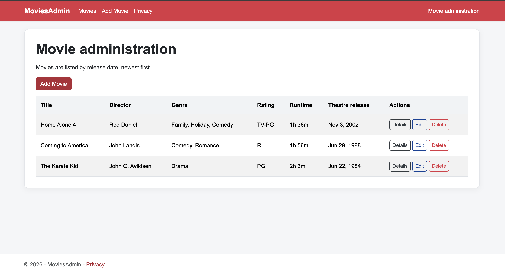
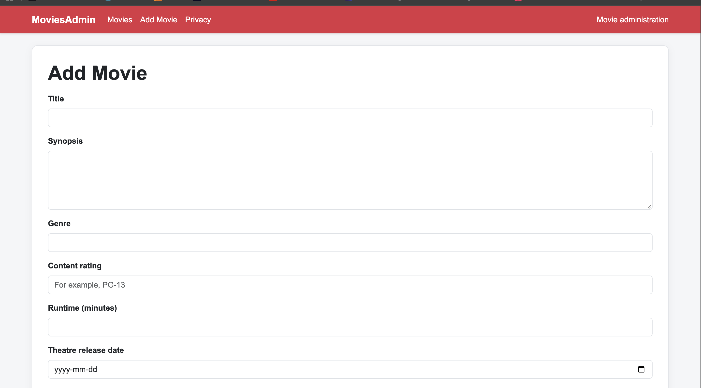
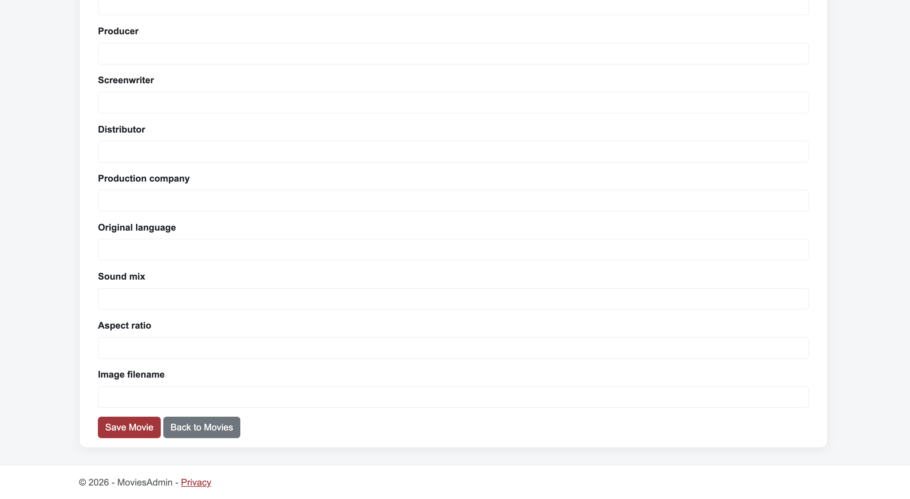
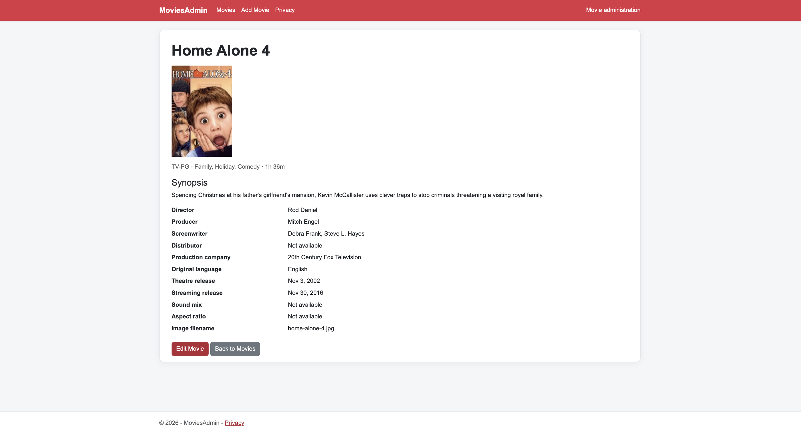
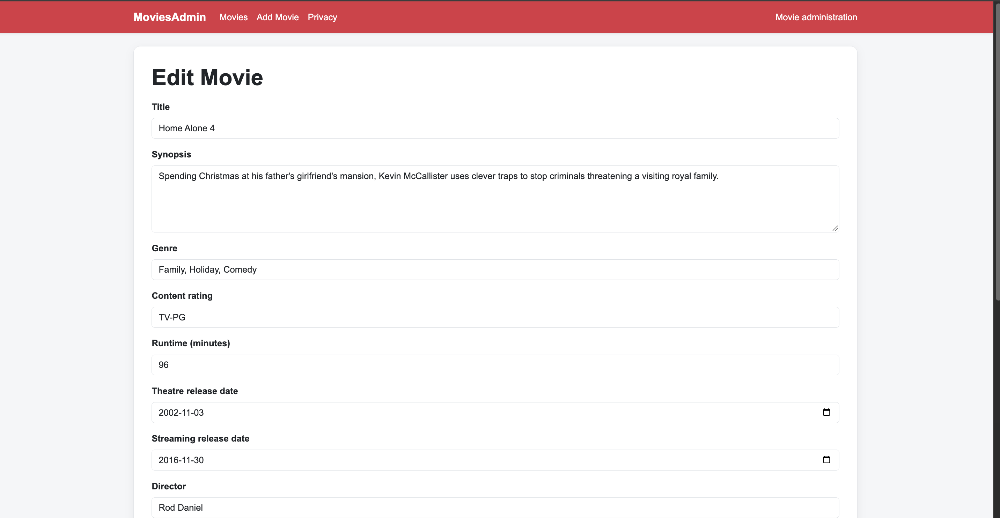
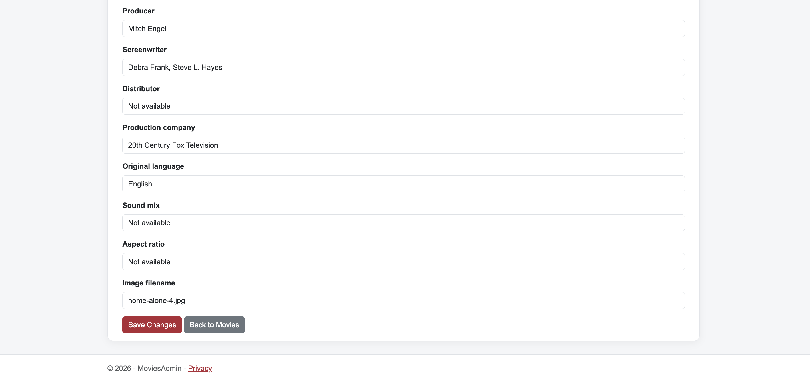
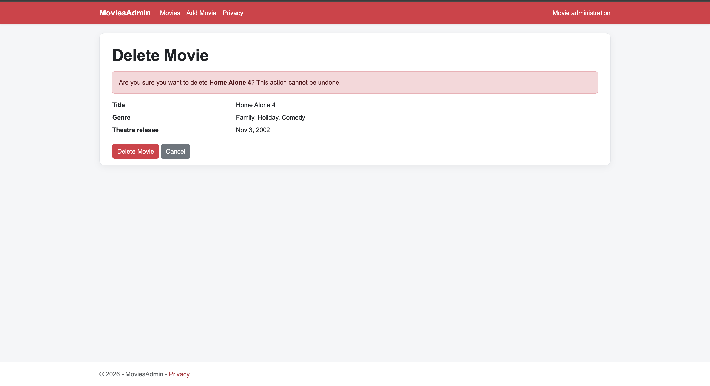

# MoviesAdmin

MoviesAdmin is the administration component of a movie review website that I am building for my Web Application Programming course at NSCC. The complete system will be developed individually over four project sprints and will work similarly to websites such as Rotten Tomatoes.

## Project overview

Sprint 1 focuses on building the administration side of the system. The application will allow an administrator to manage the movie information stored in the database.

Starting with the administration component will help establish the database structure and CRUD operations required by the larger system. Later project sprints will add movie review features for critics and a public facing website where visitors can browse movies and read reviews.

## Sprint 1 objectives

The main objective of Sprint 1 is to build a functional movie management application from the administrator standpoint. An administrator will be able to:

- Add a new movie
- View the details of a movie
- Update existing movie information
- Delete a movie
- View a summary list of all movies
- Access the appropriate action buttons for each movie

Movies displayed in the summary list will be sorted by release date.

## Movie information

Each movie record will contain the following information:

- Title
- Synopsis
- Genre
- Rating, such as G, PG, PG-13, or R
- Runtime in hours and minutes
- Release date

## Design

The application will use clear navigation and consistent styling to make movie management straightforward. It will also include its own visual identity so that the administration interface fits the branding of the larger movie review system.

## Screenshots

### Movie list

Movies are sorted by release date, newest first, with links to view,
edit and delete each movie.



### Add a movie — main information

The form collects the title, synopsis, genre, content rating,
runtime and release dates.



### Add a movie — additional information

Additional fields record production details and an image filename.



### Movie details

The details page displays the saved movie information and its image.



### Edit a movie — main information



### Edit a movie — additional information



### Delete confirmation

A confirmation page lets the user delete the movie or cancel.



## Image sources and acknowledgements

Movie images for Coming to America (1988), Home Alone 4 (2002),
and The Karate Kid (1984) were obtained from their respective
Rotten Tomatoes pages and used as sample images to test image
display in this coursework application.

Sources:

- [Coming to America (1988)](https://www.rottentomatoes.com/m/coming_to_america)
- [Home Alone 4 (2002)](https://www.rottentomatoes.com/m/home_alone_4)
- [The Karate Kid (1984)](https://www.rottentomatoes.com/m/karate_kid)

Images are credited to their respective copyright holders.
I did not create these images. MoviesAdmin is a student project
and is not affiliated with or endorsed by Rotten Tomatoes.

## Technologies

The first phase of the project uses:

- C#
- ASP.NET Core MVC
- Entity Framework Core
- SQL Server
- Docker
- HTML and CSS
- Bootstrap
- Git and GitHub

SQL Server will run inside a Docker container, while Entity Framework Core will allow the ASP.NET Core application to communicate with the database.

## Current progress

The initial ASP.NET Core MVC project has been created and tested successfully on macOS. The application currently runs locally, and the database integration and movie management functionality will be developed during Sprint 1.

## Project development

The complete movie review system will be developed over four project sprints:

1. **Movie administration:** Manage movie records and database operations.
2. **Critic functionality:** Allow critics to create and manage movie reviews.
3. **Public website:** Allow visitors to browse movies and read reviews.
4. **System completion:** Integrate, test, and improve the complete application.

## Running the application

### Requirements

Before running the project, install:

- .NET SDK
- Docker Desktop
- Git
- Visual Studio or Visual Studio Code with C# Dev Kit

### Setup

1. Clone the repository:

   ```bash
   git clone https://github.com/Johnwosu/MoviesAdmin.git
